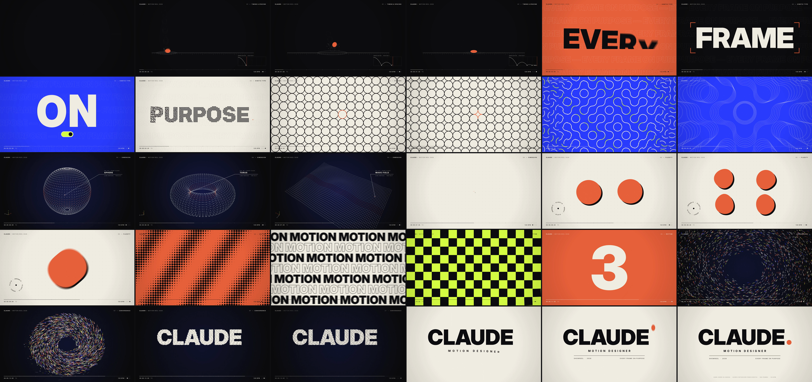

# Claude — Motion Reel 2026

A 15-second, 1920×1080 @ 60 fps motion design showreel: **[claude-showreel.mp4](claude-showreel.mp4)**.



Everything is made in code. There are no templates, stock footage, plugins or samples.

- **Picture:** `reel.html` draws every frame with Canvas 2D. Each pixel is a pure function of time, so frames render in parallel, and each frame averages 6 sub-frames inside a 198° virtual shutter for real motion blur. The blur never smears across a hard cut.
- **Sound:** `score.py` synthesizes the score with numpy. That covers the drums, supersaw pads, sidechained bass, marimba "ball" blips, metaball bloops, risers and a convolution reverb. It mixes to about −15 LUFS.
- **Sync:** both picture and sound run on a 128 BPM grid. 32 beats is exactly 15.0 s, so every cut, slam and squash lands on the music.

| Beats | Chapter | What happens |
|---|---|---|
| 0–4 | 01 Timing & Spacing | A ball under honest gravity: squash & stretch, onion-skin spacing and a live graph-editor curve. Then it dives at the lens and its colour becomes the next background. |
| 4–8 | 02 Kinetic Type | EVERY / FRAME / ON / PURPOSE. Each word is a different move: masked rise, viewfinder snap, gravity drop with a toggle, elastic stretch. Then the type pixelates into dots. |
| 8–12 | 03 Systems | The dots become circles, then diamonds, then corner arcs (a dual-grid flip). That forms a Truchet labyrinth, which turns in rotation waves before the camera dives into one ring. |
| 12–16 | 04 Dimension | The ring tilts into a 2,592-vertex point cloud: sphere → torus → kick-reactive wave field → tunnel, then a dolly through it. |
| 16–20 | 05 Fluidity | Real metaballs. A cell divides twice, sheds droplets, re-merges and floods the frame. |
| 20–24 | 06 Rhythm | A half-beat montage (halftone, sunburst, type rows, op-art, checker wave, EQ), then a 4-3-2-1 countdown. |
| 24–28 | 07 Convergence | The drop: a burst, a vortex of 3,343 particles, then a spiral into the name. |
| 28–32 | 08 End card | The opening ball returns and lands as the full stop. |

## Build

```sh
npm install            # playwright (uses its bundled Chromium)
./build.sh             # score.wav -> 900 frames -> claude-showreel.mp4  (~2 min on 4 cores)
```

- **Requirements:** Node 18+, Python 3 with numpy, and ffmpeg built with libx264.
- **Preview in a browser:** open `reel.html?play` for a real-time preview without motion blur.
- **Inspect a single frame:** open `reel.html?t=11.4`.
